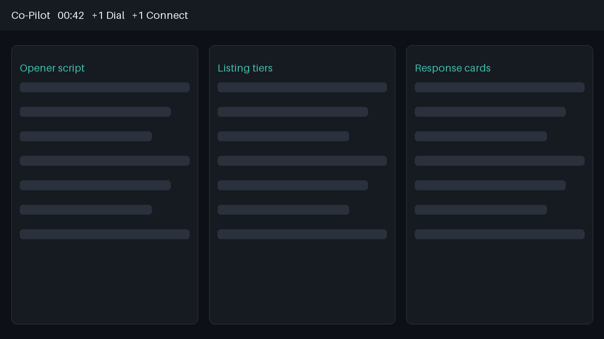
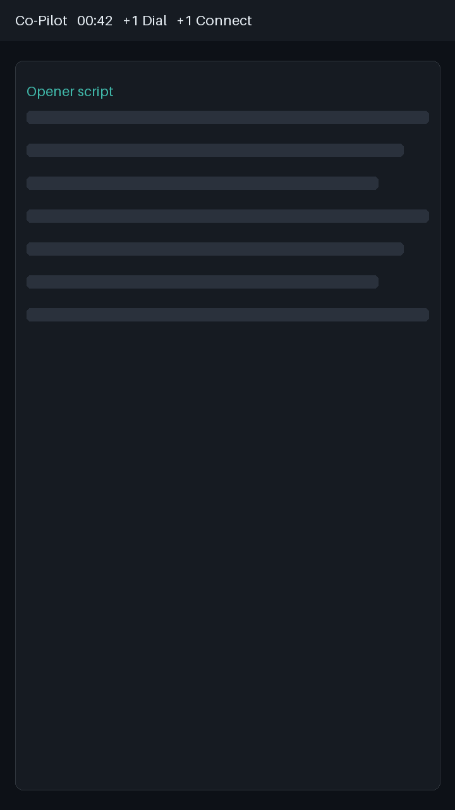
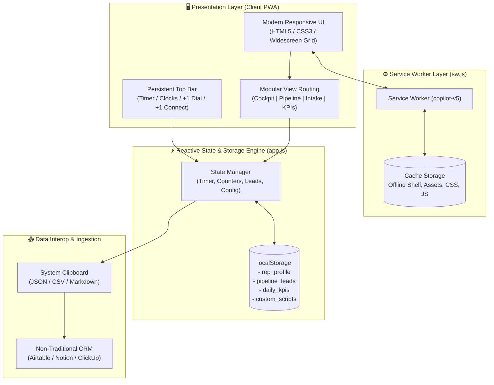

# 🎧 Outbound Sales Co-Pilot (PWA)

An ultra-low latency, privacy-first Progressive Web Application designed for high-volume B2B/B2C outbound sales representatives. Built for live call workflows, multi-region prospecting, and seamless CRM data export.

---

## 🌟 Interface & Layout Structure

```
  ┌────────────────────────────────────────────────────────────────────────┐
  │  [00:00 Timer]   [US/EU Timezone Clocks]   [+1 Dial]   [+1 Connect]    │
  ├──────────────────┬───────────────────────┬─────────────────────────────┤
  │                  │                       │                             │
  │   1. Teleprompter│   2. Tier Presenter   │   3. Live Objection         │
  │      Script HUD  │      & Pricing Deck   │      Battlecards            │
  │                  │                       │                             │
  └──────────────────┴───────────────────────┴─────────────────────────────┘
```

---

## 📸 Interface Preview

| Live Call Cockpit & Clocks | Pipeline & Email Engine |
| :---: | :---: |
|  |  |
| *3-column split view with dynamic compliance & timezone flags* | *Lead pipeline, ready-to-send email templates & CRM exports* |

---

## 🌟 Key Modules

### 1. ⏱️ Persistent Top HUD & Global Compliance Clock
* **Real-Time Regional Dialing Windows:** Automatically checks local time in **US Eastern, Central, Mountain, Pacific, UK (GMT/BST), and Central Europe (CET)**.
  * 🟢 **Green Alert:** Within permissible calling hours (9:00 AM – 8:00 PM local).
  * 🔴 **Red Alert:** Outside telemarketing boundaries (avoids TCPA/TSR violations).
* **Call Pacing Stopwatch:** Real-time call tracking with `Spacebar` pause/resume.
* **Rapid Dials & Connect Counters:** One-click metrics persistence directly in the header.

### 2. 📜 Tab 1: Live Call Cockpit
* **Teleprompter Mode:** Real-time script reader featuring amber variable highlights (`[Name]`, `[Company]`, `[Bank/Business]`).
* **Interactive Tier Cards:** Dynamic presentation of Essential, Enhanced, and Premier pricing tiers with auto-anchoring.
* **Objection Battlecards:** Instant rebuttals for common resistance: *"Why do I need this?"*, *"Send me info"*, *"Too expensive/pension"*, and *"Is this legitimate?"*.

### 3. 🗂️ Tab 2: Pipeline & Warm Follow-Up Manager
* **Kanban Stages:** Filter prospects by `Cold Lead`, `Interested - Sent Info`, `Warm Follow-Up`, `Ready to Close`, and `Closed Won`.
* **One-Click Email Generator:** Copy-ready email templates (Introductory, Post-Call Overview, and Scheduled Follow-Up) with dynamic variable injection.

### 4. 📝 Tab 3: Client Intake & Multi-Format CRM Bridge
* **Zero-Lockin Export:** Instantly parses structured customer agreements and verification records into:
  * **JSON** (for Webhooks, Zapier, n8n, Make)
  * **CSV** (for Excel, Google Sheets)
  * **Markdown Table** (for Notion, ClickUp, Airtable)

### 5. 📊 Tab 4: KPI Engine & EOD Automator
* **Symmetric 4x2 Metric Grid:** Tracks Dials, Connects, Qualified Leads, and Conversions.
* **Automatic Yield Math:** Computes Connect Rate %, Qualification Rate %, and Gross Revenue.
* **End-of-Day Markdown Generator:** Compiles daily productivity metrics into an executive-ready daily summary report.

---

## 🏗️ System Architecture



---

## 📂 File Structure

```
📂 Outbound-Sales-Co-Pilot/
├── 📄 index.html                  # Core app container & component markup
├── 📄 manifest.webmanifest        # PWA schema (app icons, shortcuts, theme)
├── 📄 sw.js                       # Service worker with offline asset caching
├── 📄 offline.html                # Standalone fallback for disconnected states
├── 📄 robots.txt                  # Blocks search crawlers from private call logs
├── 📄 README.md                   # Documentation & implementation spec
├── 📁 css/
│   └── 🎨 styles.css              # Custom dark-theme design tokens & scrollbars
├── 📁 js/
│   └── ⚡ app.js                  # PWA state machine, tour engine, & calculations
├── 📁 icons/
│   ├── 🖼️ icon-192.png            # Standard home screen icon
│   ├── 🖼️ icon-512.png            # App store / splash icon
│   ├── 🖼️ icon-maskable-192.png   # Adaptive Android shape icon
│   └── 🖼️ favicon.ico             # Desktop browser favicon
├── 📁 screenshots/
│   ├── 🖼️ desktop-wide.png        # Wide layout preview for rich PWA prompt
│   └── 🖼️ mobile-narrow.png       # Mobile layout preview
└── 📁 .well-known/
    └── 🔗 assetlinks.json         # Android Trusted Web Activity verification
```

---

## ⌨️ Productivity Hotkeys

| Key | Context | Action |
| :---: | :--- | :--- |
| `Space` | Global *(outside inputs)* | Start / Pause Call Timer |
| `D` | Global | Increment `Total Dials` (+1) |
| `C` | Global | Increment `Connects` (+1) and `Total Dials` (+1) |
| `1` – `6` | Cockpit Tab | Switch Active Call Script |
| `?` | Global | Open Interactive Tour & Keyboard Cheatsheet |

---

## 🚀 Deployment & Setup

### Option 1: GitHub Pages
1. Push or commit this repository to your GitHub account.
2. Go to **Settings > Pages**.
3. Under **Build and deployment > Branch**, select `main` (or `master`) and folder `/ (root)`.
4. Click **Save**. The live URL will be active within minutes.

### Option 2: Local Development Server
Service workers require an HTTPS origin or a trusted `localhost` context:
```bash
# Clone the repository
git clone https://github.com/your-username/Outbound-Sales-Co-Pilot.git

# Navigate into the project directory
cd Outbound-Sales-Co-Pilot

# Start a local web server
python3 -m http.server 8080
```
Open `http://localhost:8080` in your browser.

---

## 🔒 Privacy & Data Sovereignty

* **100% Client-Side:** No external telemetry, tracking, or remote databases. All prospect names, phone numbers, notes, and call metrics stay inside the browser's local storage.
* **Data Portability:** Use **Settings > Export Backup (.json)** inside the application to create local backups or migrate across machines.
